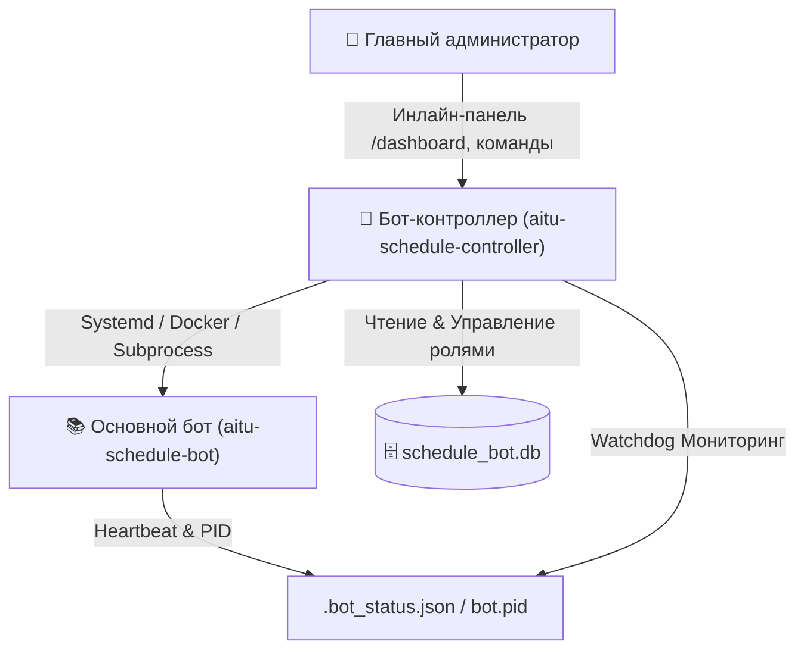

# 👑 AITU Schedule Controller · Supervisor & Watchdog
### Независимая консоль супер-администратора и отказоустойчивый супервизор
#### Управление службами • Авто-восстановление • Мониторинг логов • Синхронизация замен Moodle

[🏛 Архитектура](#-архитектура-решения) •
[✨ Возможности](#-возможности-бота-контроллера) •
[🛡 Политика развёртывания](#-политика-развёртывания) •
[🔒 Лицензия](#-лицензия-и-права-доступа)

---

> [!IMPORTANT]
> **Проприетарное программное обеспечение. Развёртывание строго ограничено.**  
> Развёртывание, хостинг, установка и запуск бота-контроллера **категорически запрещены всем лицам, кроме создателей проекта или лиц, получивших прямое письменное разрешение от создателей**. Данный сервис предназначен исключительно для внутреннего администрирования инфраструктуры колледжа AITU и защищён строгим whitelist по Telegram ID.

---

## 🏛 Архитектура решения

Для обеспечения максимальной отказоустойчивости и безопасности супер-админка полностью изолирована от основного бота:

### Преимущества выноса супер-админки:
1. **Автономность при сбоях:** если основной бот зависнет или упадёт при нехватке памяти, контроллер останется онлайн, мгновенно отправит тихое уведомление супер-админу и выполнит авто-восстановление.
2. **Безопасность:** критические инфраструктурные операции (перезапуск процессов, выполнение `git pull`, чтение системных логов сервера, управление ролями в БД) физически изолированы в отдельном боте с фильтрацией по `SUPERADMIN_IDS`.
3. **Чистота кода:** основной бот сфокусирован на студентах, старостах и расписании, не перегружаясь инфраструктурной логикой.

---

## ✨ Возможности бота-контроллера

* 📊 **Единый дашборд (`/dashboard`):**
  * Статус целевого бота (🟢 Онлайн / 🔴 Остановлен / 🟡 Не отвечает).
  * Режим запуска (`SYSTEMD`, `DOCKER`, `PROCESS`), PID, Uptime, потребление памяти (RSS) и CPU.
  * Текущий коммит Git, ветка, автор, дата и количество отстающих коммитов от `origin/main`.
  * Статистика базы данных (студенты, группы, беседы, активные замены).
  * Нагрузка на хост-сервер (CPU, RAM, свободное место на диске, серверное время).
* ⚡️ **Управление процессом (`/restart`, `/start_bot`, `/stop_bot`, `/kill_bot`):**
  * Мягкий перезапуск бота с обновлением кода.
  * Остановка и запуск службы.
  * Принудительное завершение (`kill -9`) зависшего процесса.
* 📦 **Git и Обновления (`/pull`, `/commits`):**
  * Подтягивание обновлений с GitHub в 1 клик.
  * Опция «Pull & Рестарт» — скачивание свежего кода с немедленным перезапуском.
  * Авто-детект изменений в `requirements.txt`.
  * Просмотр последних коммитов репозитория.
* 👥 **Управление ролями и старостами (`/roles`, `/set_role`):**
  * Просмотр всех привилегированных пользователей (`Superadmin`, `Admin`, `Starosta`, `Zam. Starosty`).
  * Поиск пользователей по `@username` или `Telegram ID`.
  * Назначение администраторов бота расписания.
  * Назначение старосты на конкретную академическую группу (например, `9ПО-43к`).
  * Сброс роли обратно в `student`.
* 📜 **Журнал логов (`/logs`):**
  * Чтение последних строк логов (из `journalctl`, `docker logs` или `bot.log`).
  * Быстрая фильтрация: «Все события», «Только ошибки (ERROR)», «Только предупреждения (WARNING)».
  * Кнопка моментального обновления без флуда новыми сообщениями.
* 📢 **Экстренная рассылка (`/broadcast`):**
  * Массовая отправка важных объявлений от администрации всем студентам колледжа, только в групповые чаты (беседы) или студентам конкретной группы.
  * Защита от спам-лимитов Telegram (`FloodWait`, троттлинг).
* 👁 **Сторожевой сервис (Watchdog):**
  * Фоновый асинхронный цикл мониторинга каждые 30 секунд.
  * Мгновенный сигнал супер-админам при неожиданном падении основного бота.
  * Автоматический перезапуск (`AUTO_RESTART_ON_CRASH=true`) при краше.
* 🧪 **Диагностика (`/diagnostics`):**
  * Экспресс-проверка доступности БД, валидности Git, целостности Heartbeat и HTTP Healthcheck.

---

## 🛡 Политика развёртывания

> [!CAUTION]
> ### ⛔️ Запрет на независимое развёртывание
> **Развёртывание, хостинг, установка и запуск данного программного обеспечения на любых серверах, VPS, облачных платформах или локальных машинах категорически запрещены всем лицам и организациям, кроме оригинальных создателей (авторов) проекта либо лиц, получивших прямое письменное разрешение от создателей.**
> 
> Бот-контроллер является закрытым административным инструментом прямого доступа к серверам и базе данных колледжа AITU. Любые попытки несанкционированного клонирования, запуска или вмешательства в работу сервиса преследуются по закону об авторском праве и компьютерной безопасности.

### 🏗 Архитектура и стек технологий (Справочная информация)
Данный раздел приведён исключительно для ознакомления со структурой компонентов платформы:
- **Ядро и фреймворк:** Python 3.11+, Aiogram 3.13 (асинхронный бот-фреймворк, FSM, строгая фильтрация по `SUPERADMIN_IDS`).
- **Служба мониторинга (Watchdog):** Асинхронный фоновый цикл проверки состояния процессов с интервалом 30 секунд.
- **Интеграция с хостом:** Взаимодействие с системным менеджером `systemd` через `systemctl` / `journalctl` и прямое управление процессами.
- **Интеграция с Moodle:** Парсер семестровых расписаний и приказов с портала СДО (`aiohttp` + `python-docx` + `openpyxl`).
- **База данных:** Прямое защищённое асинхронное подключение к SQLite WAL базе данных расписания.
- **Безопасность:** Двухуровневая аутентификация по Telegram User ID, аудит всех действий супер-администраторов.

---

## 🔒 Лицензия и права доступа

**Proprietary & Confidential Software License**

© 2026 Разработчики AITU Schedule Bot. Все права защищены.

- **🚫 Запрет развёртывания:** Развёртывание, запуск, публикация и хостинг любых компонентов данного продукта (бот-контроллер, супервизор, парсеры и скрипты) третьими лицами **категорически запрещены**. Исключительное право на развёртывание и эксплуатацию сервиса принадлежит только оригинальным авторам (создателям) проекта или лицам, получившим их прямое письменное разрешение.
- **🔐 Закрытый доступ:** Исходный код, архитектура, механизмы супервизора и сопутствующая документация являются конфиденциальной интеллектуальной собственностью. Запрещено несанкционированное копирование, распространение, создание производных версий или форков.
- **👑 Доступ супер-администратора:** Взаимодействие с ботом разрешено исключительно доверенным администраторам, внесённым в конфигурацию по Telegram ID.
