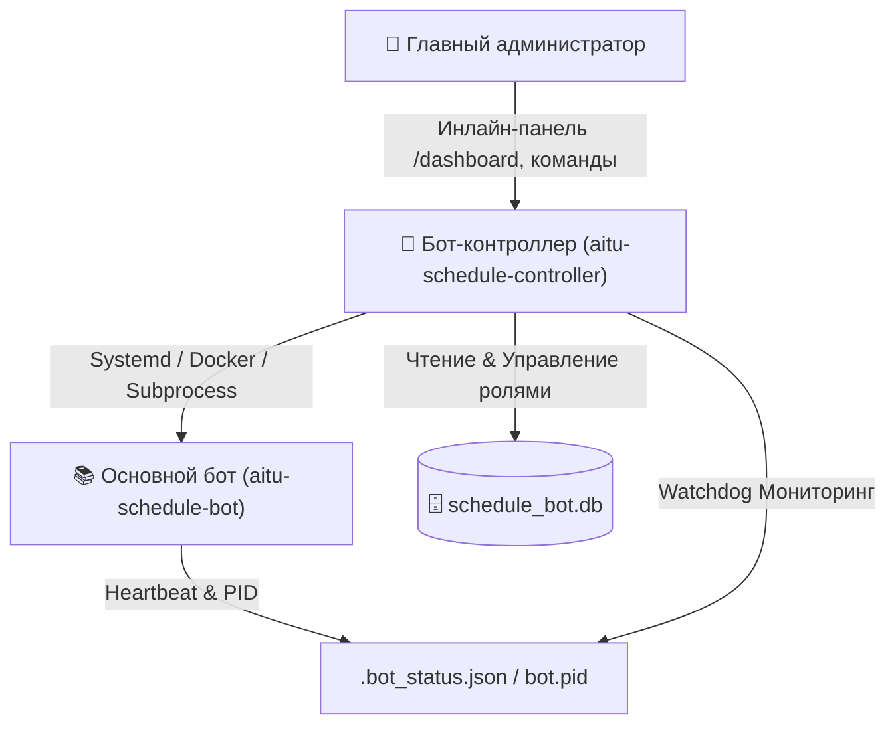

# 👑 AITU Schedule Controller (Supervisor & Super Admin)

Выделенный бот-контроллер и независимая консоль **Супер-администратора (Supervisor / Watchdog)** для управления основным ботом расписания колледжа AITU ([aitu-schedule-bot](https://github.com/wxrrry/aitu-schedule-bot)).

---

## 🏛 Архитектура решения

Для обеспечения отказоустойчивости и безопасности супер-админка полностью изолирована от основного бота:



### Преимущества выноса супер-админки:
1. **Автономность при сбоях:** если основной бот зависнет из-за ошибки в сторонних сервисах или упадёт при нехватке памяти, контроллер останется онлайн, мгновенно уведомит супер-админа и выполнит авто-восстановление.
2. **Безопасность:** критические инфраструктурные операции (перезапуск процессов, выполнение `git pull`, чтение системных логов сервера, назначение прав администраторов) физически изолированы в отдельном боте с жёстким whitelist по `SUPERADMIN_IDS`.
3. **Чистота кода:** основной бот фокусируется на студентах, старостах и расписании, не перегружаясь инфраструктурной логикой.

---

## ✨ Возможности бота-контроллера

* 📊 **Единый дашборд (`/dashboard`):**
  * Статус целевого бота (🟢 Онлайн / 🔴 Остановлен / 🟡 Не отвечает).
  * Режим запуска (`SYSTEMD`, `DOCKER`, `PROCESS`), PID, Uptime, потребление памяти (RSS) и CPU.
  * Текущий коммит Git, ветка, автор, дата и количество отстающих коммитов от `origin/main`.
  * Статистика базы данных (студенты, группы, беседы, активные замены).
  * Нагрузка на хост-сервер (CPU, RAM, свободное место на диске, серверное время).
* ⚡️ **Управление процессом (`/restart`, `/start_bot`, `/stop_bot`, `/kill_bot`):**
  * Мягкий перезапуск бота с обновлением кода.
  * Остановка и запуск службы.
  * Принудительное завершение (`kill -9`) зависшего процесса.
* 📦 **Git и Обновления (`/pull`, `/commits`):**
  * Подтягивание обновлений с GitHub в 1 клик.
  * Опция «Pull & Рестарт» — скачивание свежего кода с немедленным перезапуском.
  * Авто-детект изменений в `requirements.txt`.
  * Просмотр последних коммитов репозитория.
* 👥 **Управление ролями и старостами (`/roles`, `/set_role`):**
  * Просмотр всех привилегированных пользователей (`Superadmin`, `Admin`, `Starosta`, `Zam. Starosty`).
  * Поиск пользователей по `@username` или `Telegram ID`.
  * Назначение администраторов бота расписания.
  * Назначение старосты на конкретную академическую группу (например, `9ПО-43к`).
  * Сброс роли обратно в `student`.
* 📜 **Журнал логов (`/logs`):**
  * Чтение последних строк логов (из `journalctl`, `docker logs` или `bot.log`).
  * Быстрая фильтрация: «Все события», «Только ошибки (ERROR)», «Только предупреждения (WARNING)».
  * Кнопка моментального обновления без флуда новыми сообщениями.
* 📢 **Экстренная рассылка (`/broadcast`):**
  * Массовая отправка важных объявлений от администрации всем студентам колледжа, только в групповые чаты (беседы) или студентам конкретной группы.
  * Защита от спам-лимитов Telegram (`FloodWait`, троттлинг).
* 👁 **Сторожевой сервис (Watchdog):**
  * Фоновый асинхронный цикл мониторинга каждые 30 секунд.
  * Мгновенный сигнал супер-админам при неожиданном падении основного бота.
  * Автоматический перезапуск (`AUTO_RESTART_ON_CRASH=true`) при краше.
* 🧪 **Диагностика (`/diagnostics`):**
  * Экспресс-проверка доступности БД, валидности Git, целостности Heartbeat и HTTP Healthcheck (порт 8080).

---

## 🚀 Установка и запуск

### 1. Клонирование и зависимости
```bash
cd aitu-schedule-controller
python -m venv venv

# На Linux:
source venv/bin/activate
# На Windows:
venv\Scripts\activate

pip install -r requirements.txt
```

### 2. Конфигурация (.env)
Скопируйте пример файла конфигурации:
```bash
cp .env.example .env
```
Заполните обязательные поля:
* `CONTROLLER_BOT_TOKEN` — токен нового бота, созданного в [@BotFather](https://t.me/BotFather).
* `SUPERADMIN_IDS` — ваш числовой ID Telegram (например `1019252177,792569339`).
* `TARGET_BOT_DIR` — путь к папке `aitu-schedule-bot` (по умолчанию `../aitu-schudele` или `/opt/aitu-schedule-bot`).
* `RUN_MODE` — `auto` (авто-определение), либо явно `systemd`, `docker`, `process`.

### 3. Локальный запуск для проверки
```bash
python main.py
```

### 4. Развёртывание на Linux VPS через Systemd
1. Скопируйте файл службы:
   ```bash
   sudo cp deploy/aitu-controller.service /etc/systemd/system/
   ```
2. Перечитайте конфигурацию systemd и активируйте автозапуск:
   ```bash
   sudo systemctl daemon-reload
   sudo systemctl enable aitu-controller
   sudo systemctl start aitu-controller
   ```
3. Проверьте статус службы:
   ```bash
   sudo systemctl status aitu-controller
   ```
